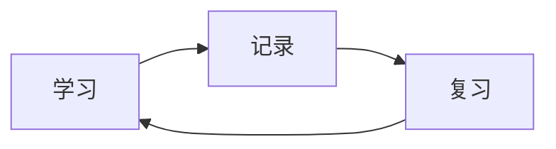

---
tags:
  - 首页
---

# 我的知识库

欢迎来到我的个人知识库。这里整理了我的学习笔记、技术文档、研究资料和投资思考。

## 内容板块

- **[学习笔记](learning/index.md)**：课程学习、读书笔记、知识总结。
- **[技术文档与代码片段](tech/index.md)**：开发文档、配置说明、常用代码片段。
- **[研究资料](research/index.md)**：专题研究、资料汇总、调研记录。
- **[个人投资](investment/index.md)**：投资方法论、学习笔记与复盘（不记录真实金额与持仓）。

## 如何使用

- 使用顶部导航切换板块。
- 使用右上角搜索框进行全文搜索。
- 使用右上角图标切换深色 / 浅色模式。
- 使用 [标签](tags.md) 页面按标签浏览内容。

!!! tip "提示"
    新建页面时，在文件开头的 front matter 中写上 `tags`，即可在标签页中归类。

行内公式示例：$E = mc^2$。

$$
\int_a^b f(x)\,\mathrm{d}x = F(b) - F(a)
$$

